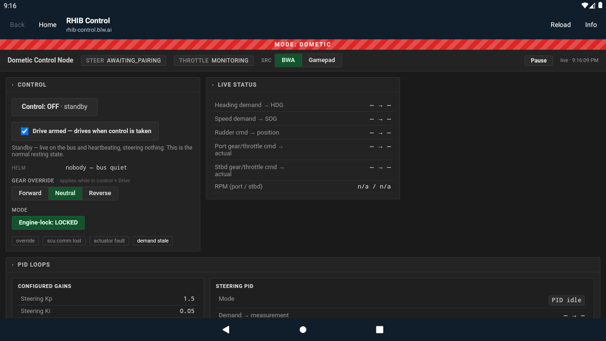

# MAR-188 — version 0.1.1 login validation

Tested on 2026-10-16, using the existing Android 11 ARM64 emulator and WebView 91.

The user completed Microsoft authentication, but the wrapper rejected subsequent
navigation to `rhib.blw.ai`. Allowing that destination exposed another rejected
navigation to `rhib-grafana.blw.ai`. Both observed BWA hosts are now explicitly
allowed; the HTTPS and exact-host policy remains in place.

Blocked-link messages now show only the destination origin. Paths, userinfo,
queries, fragments, and opaque URL payloads are omitted. Popup restrictions use
a separate message. Debug builds log the same sanitized diagnostic.

## Evidence

- Before adding the host, the RHIB redirect regression test failed on API 23 and 30.
- `./gradlew test lint :app:lintRhibRelease assembleDebug assembleRelease --no-daemon`
  passed after the fix: 28 tests per variant, 56 total, with zero failures or skips.
- Debug and release lint reported no issues.
- `adb install -r` updated the emulator while preserving app data.
- The authenticated RHIB Control interface rendered using the user's existing
  sign-in session. No vessel controls were operated.
- Version code is 2; version name is 0.1.1.



## Delivered build checksums

```text
edff42532dd35551c723840146d39fd41c56c0226a83f72f39c09b998cbabe6f  rhib-control-0.1.1-debug.apk
52bc6aa66370e345c22e6ebf79d696a55442ca512068d5f4741db6d3b06a4884  rhib-control-0.1.1-unsigned.apk
```

## Not tested

Physical MFD installation/signing, MFD WebView compatibility, fresh-account MFA,
long-term session persistence, vessel commands, and stale-data behavior remain
unverified. Rendering the control interface does not validate vessel operation.

The [0.1.0 validation record](validation.md) describes the earlier prototype.
