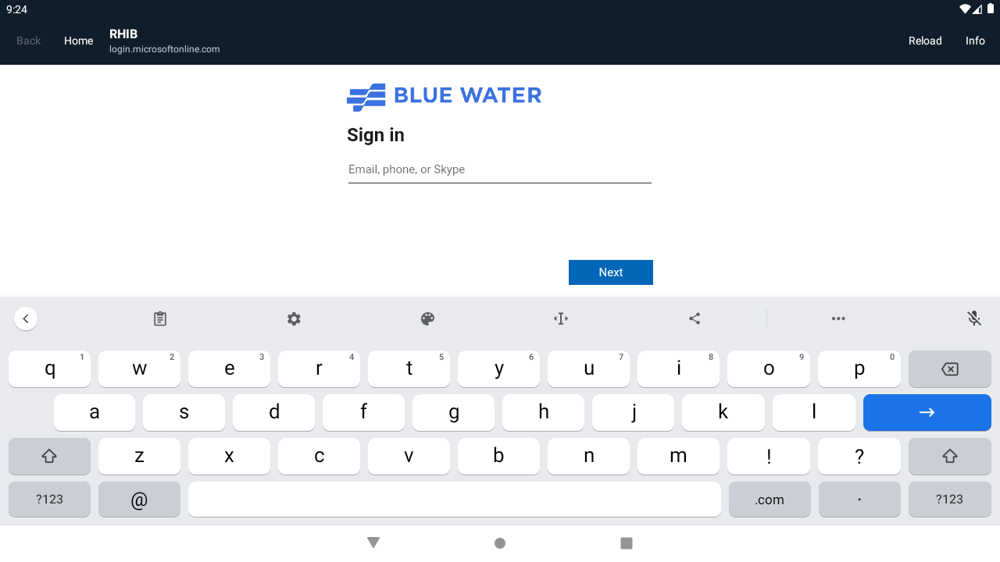

# MAR-188 — version 0.2.0 portal builds

Validated on 2026-10-16. One shell now produces three independent apps.

| Flavor | Launcher name | Release package | Start URL |
| --- | --- | --- | --- |
| rhibControl | RHIB Control | ai.blw.mfd.rhibcontrol | https://rhib-control.blw.ai/ |
| rhib | RHIB | ai.blw.mfd.rhib | https://rhib.blw.ai/ |
| dreadnought | Dreadnought | ai.blw.mfd.dreadnought | https://dreadnought.blw.ai/ |

## Observed results

- `./gradlew :app:verifyPortals --no-daemon` passed. This task includes full lint,
  tests, and assembly for all six debug/release variants.
- Each variant ran 29 tests: 174 total, with no failures, errors, or skips.
- All six lint reports contained “No issues found.”
- `aapt dump badging` verified each APK's distinct package ID, launcher label,
  version code 3, and version name 0.2.0 (with a debug suffix for debug builds).
- Public HTTPS requests for all three start URLs reached the same Cloudflare
  Access tenant. New RHIB and Dreadnought apps rendered Microsoft sign-in in the
  Android 11 emulator.
- `adb install -r` succeeded for all three debug APKs. Android's package list
  confirmed all three were installed simultaneously.
- RHIB Control retains its existing package ID for in-place updates; its Gradle
  flavor is now `rhibControl`. The new `rhib` flavor is the separate RHIB app.
- All apps allow links to the three requested BWA sites, RHIB Grafana, and the
  configured sign-in hosts. Package-private WebView storage keeps sessions separate.



The emulator was left running for user testing. No vessel controls were operated.
The user's sign-in input was not added to this repository.

## Delivered APK checksums

```text
2f21943ec5e4d92e2fd06e32c0008a8ab23fc2bdb48ef71f58f28b9b5ff80b7a  dreadnought-0.2.0-debug.apk
c335d2054748a8144574dc21db735ef5736d47c34290e5d92f3132e52f6e2c14  dreadnought-0.2.0-unsigned.apk
e0b37e017031476f20b54abbd0a781fd0f1a43ac05fa87bdce23746b8762dd07  rhib-0.2.0-debug.apk
659c41014cdbca5dfb6d351184212506542177d08b3b55bf0de65ed839dd01b9  rhib-0.2.0-unsigned.apk
7827876b1b6f2ba0bfd3133e149eab06a970ae7f4a05a7181070068a329f54ed  rhib-control-0.2.0-debug.apk
fe72ec665fc6be6f3a9abece9978383877516b68d8b1eb122a9779a033671a33  rhib-control-0.2.0-unsigned.apk
```

Unsigned APKs are for Raymarine's signing process; debug APKs are for ordinary
Android test devices. GitHub Actions publishes these as separate artifact groups.

## Not tested

Full authenticated sessions in the new RHIB and Dreadnought packages, physical
MFD installation/signing, MFD WebView behavior, alarm integration, and vessel
operation remain unverified. The prior authenticated RHIB Control result is
recorded in [version 0.1.1 validation](validation-0.1.1.md).
