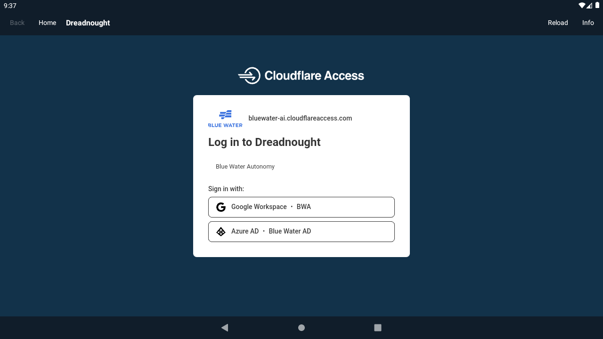

# MAR-188 — version 0.2.1 compact header

Validated on 2026-10-16.

- Removed the current hostname from the shared header and deleted its unused
  display code. The app name remains centered vertically.
- Reduced header height from 56dp to 48dp in RHIB Control, RHIB, and Dreadnought.
- `./gradlew :app:verifyPortals --no-daemon` passed: 168 tests across six variants,
  zero failures/errors/skips, and six clean lint reports. The obsolete hostname
  display helper and its test were removed.
- Updated all three debug apps in the Android 11 emulator with `adb install -r`.
- Visually checked Dreadnought's 48dp header without a hostname subtitle.
- Packaged all debug and unsigned release APKs as version 0.2.1, version code 4.

Physical MFD testing and the other unverified items in the
[0.2.0 validation record](validation-0.2.0.md) remain outstanding.
