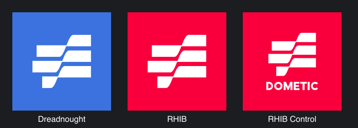

# MAR-188 — version 0.2.2 launcher icons

Changed on 2026-10-21.

- Replaced the shared placeholder icon with the Blue Water mark from blw.ai:
  - Dreadnought: white on BWA Blue `#3B72DF`.
  - RHIB: white on blw.ai's red `#F9003C`.
  - RHIB Control: the same red, with DOMETIC under the mark.
- The mark was traced from blw.ai's 256 px app icon. Rendered back at 256 px,
  0.85% of its edge pixels differ from the original by more than half intensity,
  which is anti-aliasing rather than shape error.
- `scripts/launcher_icons.py` generates the VectorDrawables. The lettering is
  drawn as shapes, so no font file is embedded. Holes use opposite winding
  because `android:fillType` requires API 24 and the minimum is API 23.
- Bumped the version to 0.2.2 (local version code 5).

This preview is an SVG rendering of the same path data, not a device screenshot.
No local Android SDK was available. CI on PR #4 runs the build, lint, and unit
tests. The icons have not been checked on an Android launcher or on the MFD's
app launcher.
